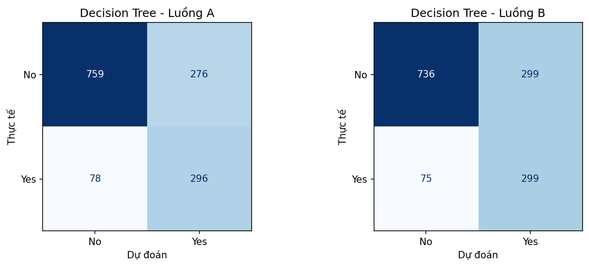
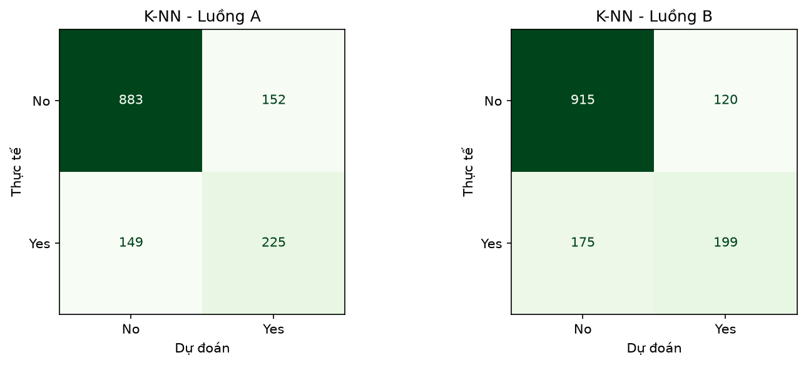
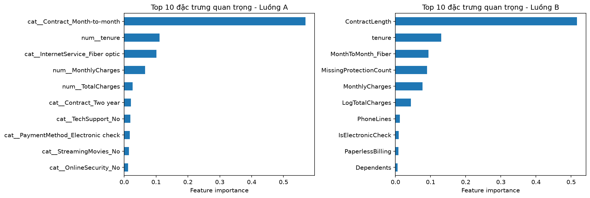
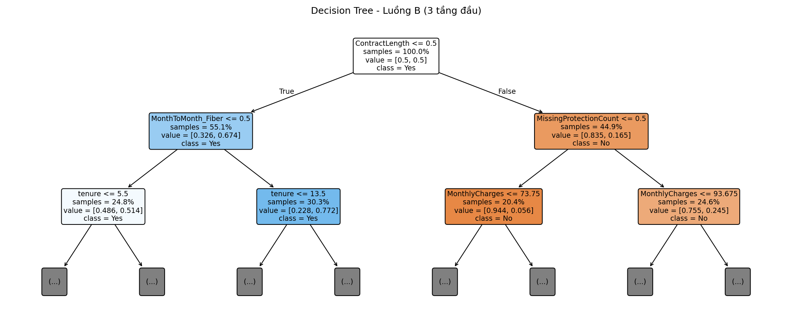
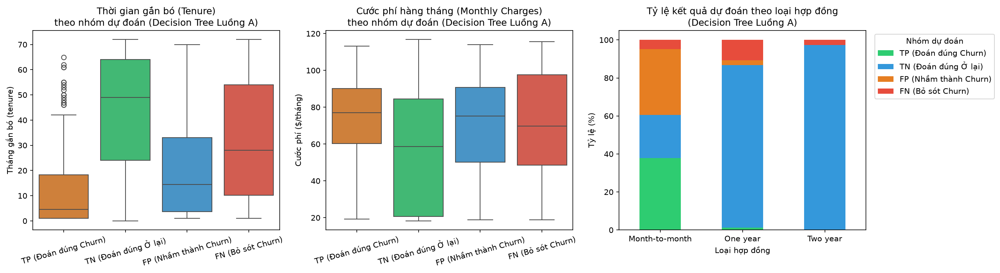

# LỜI CAM ĐOAN

Chúng tôi xin cam đoan báo cáo bài tập lớn học phần **FIT4013 -- Nhập môn Học Máy** với đề tài *"Dự đoán khách hàng rời bỏ dịch vụ viễn thông (Telco Customer Churn Prediction)"* này là kết quả tìm hiểu, thiết kế, lập trình và thực nghiệm độc lập của Nhóm 4.

Toàn bộ quy trình khám phá dữ liệu (EDA), phân chia tập dữ liệu chống rò rỉ (Data Leakage), thiết kế hai luồng tiền xử lý (Luồng A và Luồng B), huấn luyện các mô hình Cây quyết định (Decision Tree), K-Láng giềng gần nhất (K-NN), kiểm thử tự động, phân tích lỗi định lượng và xây dựng ứng dụng giao diện web tương tác là do các thành viên trong nhóm trực tiếp xây dựng và thực thi trên máy tính cá nhân. Mọi số liệu thực nghiệm, độ đo Accuracy, Precision, Recall, F1-score, hình ảnh ma trận nhầm lẫn và biểu đồ phân tích lỗi trình bày trong báo cáo đều là kết quả chạy thật 100% của hệ thống mã nguồn.

Chúng tôi xin chịu hoàn toàn trách nhiệm về tính chính xác, trung thực và liêm chính học thuật của toàn bộ nội dung báo cáo.

*Hà Nội, ngày 16 tháng 11 năm 2026*  
**Nhóm sinh viên thực hiện**  
Phạm Ngọc Hùng -- Bùi Đình Mạnh -- Phạm Thế Đức -- La Văn Hải

---

# LỜI CẢM ƠN

Chúng em xin gửi lời cảm ơn chân thành và sâu sắc nhất tới Ban Giám hiệu **Trường Đại học Đại Nam**, Ban Chủ nhiệm Khoa Công nghệ thông tin cùng toàn thể quý thầy cô giáo đã tận tâm truyền đạt những nền tảng kiến thức quý báu và tạo mọi điều kiện học tập thuận lợi nhất cho chúng em trong suốt quá trình theo học học phần **FIT4013 -- Nhập môn Học Máy**.

Chúng em xin đặc biệt bày tỏ lòng biết ơn chân thành tới Giảng viên hướng dẫn học phần -- ThS. Lê Thị Thùy Trang đã tận tình giảng dạy, định hướng phương pháp luận nghiên cứu khoa học, tận tình giải đáp các vướng mắc chuyên môn và đóng góp những ý kiến vô cùng xác đáng giúp nhóm hoàn thiện đề tài bài tập lớn một cách chỉn chu và đúng chuẩn mực học thuật.

Mặc dù các thành viên trong nhóm đã dành nhiều tâm huyết và nỗ lực tối đa để hoàn thiện sản phẩm và báo cáo, song do kiến thức và kinh nghiệm thực tiễn còn đang trong giai đoạn tích lũy, bài làm khó tránh khỏi những điểm hạn chế nhất định. Nhóm kính mong nhận được những ý kiến nhận xét, góp ý quý báu của quý thầy cô để sản phẩm và năng lực chuyên môn của chúng em ngày một hoàn thiện hơn.

*Hà Nội, ngày 16 tháng 11 năm 2026*  
**Nhóm sinh viên thực hiện**  
Phạm Ngọc Hùng -- Bùi Đình Mạnh -- Phạm Thế Đức -- La Văn Hải

---

# KÍ HIỆU CÁC CỤM TỪ VIẾT TẮT

| TỪ VIẾT TẮT | TÊN ĐẦY ĐỦ CỦA TỪ VIẾT TẮT |
| :--- | :--- |
| **ML** | Machine Learning (Học máy) |
| **EDA** | Exploratory Data Analysis (Phân tích khám phá dữ liệu) |
| **DT** | Decision Tree (Cây quyết định) |
| **K-NN** | K-Nearest Neighbors (Thuật toán K-Láng giềng gần nhất) |
| **CV** | Cross-Validation (Kiểm định chéo phân tầng) |
| **FN** | False Negative (Bỏ sót khách hàng rời mạng -- Dự đoán Nhầm thành Ở lại) |
| **FP** | False Positive (Nhầm lẫn khách hàng trung thành -- Dự đoán Nhầm thành Rời bỏ) |
| **TP** | True Positive (Dự đoán Đúng khách hàng rời bỏ dịch vụ) |
| **TN** | True Negative (Dự đoán Đúng khách hàng ở lại với dịch vụ) |
| **CM** | Confusion Matrix (Ma trận nhầm lẫn) |
| **CSKH** | Chăm sóc khách hàng |
| **API** | Application Programming Interface (Giao diện lập trình ứng dụng) |
| **CSDL** | Cơ sở dữ liệu |
| **UI** | User Interface (Giao diện người dùng) |

---

# LỜI MỞ ĐẦU

Trong bối cảnh nền kinh tế số và sự phát triển bùng nổ của hạ tầng mạng viễn thông, thị trường cung cấp dịch vụ viễn thông đã bước vào giai đoạn bão hòa với sự cạnh tranh gay gắt giữa các nhà mạng. Việc duy trì và chăm sóc khách hàng hiện hữu đóng vai trò sống còn, bởi các nghiên cứu kinh tế đã chỉ ra rằng chi phí để tiếp cận và thu hút một khách hàng mới thường tốn kém gấp 5 đến 7 lần so với chi phí duy trì một khách hàng sẵn có. Khi một khách hàng rời mạng (*Customer Churn*), doanh nghiệp không chỉ mất đi dòng doanh thu định kỳ mà còn đánh mất thị phần vào tay đối thủ cạnh tranh.

Để giải quyết bài toán cấp thiết đó, nhóm sinh viên Nhóm 4 lựa chọn thực hiện **Đề tài 9: Dự đoán khách hàng rời bỏ dịch vụ viễn thông (Telco Customer Churn Prediction)** thuộc học phần **FIT4013 -- Nhập môn Học Máy**. Dự án tập trung ứng dụng các kỹ thuật học máy có giám sát hiện đại nhằm phân tích dữ liệu lịch sử khách hàng, phát hiện sớm các đặc trưng rủi ro cao và đưa ra dự báo chính xác giúp bộ phận Chăm sóc khách hàng (CSKH) có chính sách can thiệp kịp thời.

Báo cáo bài tập lớn của nhóm được cấu trúc chặt chẽ thành 6 chương nội dung chính:
- **Chương 1:** Giới thiệu bài toán và phân tích yêu cầu (Bối cảnh, mục tiêu, khám phá dữ liệu EDA chuyên sâu).
- **Chương 2:** Thiết kế giải pháp và quy trình học máy (Quy trình Pipeline tổng thể, nguyên tắc cô lập chống Data Leakage, thiết kế Luồng A và Luồng B, không gian siêu tham số).
- **Chương 3:** Phân tích mã nguồn và chức năng hệ thống (Kiến trúc module hóa, bảng phân công nhiệm vụ, phân tích các hàm then chốt, bộ kiểm thử tự động unit tests).
- **Chương 4:** Thử nghiệm và kết quả (Xác lập mô hình Baseline đối sánh, kiểm định chéo 5-fold, bảng kết quả 5 mô hình trên tập Test chung, trực quan hóa ma trận nhầm lẫn và cây quyết định).
- **Chương 5:** Thảo luận, so sánh và phân tích lỗi (Đối chiếu bước nhảy vọt so với Baseline, phân tích ưu nhược điểm Decision Tree vs K-NN dưới góc độ kinh doanh viễn thông, mổ xẻ định lượng các ca lỗi FN/FP).
- **Chương 6:** Tổng kết và hướng phát triển (Đánh giá mức độ đáp ứng mục tiêu, giới thiệu ứng dụng web demo Streamlit, hạn chế và hướng mở rộng).
- **Phần Kết luận, Phụ lục và Danh mục tài liệu tham khảo.**

---

# CHƯƠNG 1. ĐẶT VẤN ĐỀ VÀ PHÂN TÍCH YÊU CẦU

## 1.1. Giới thiệu bài toán

### 1.1.1. Bối cảnh thực tế
Ngành viễn thông và dịch vụ Internet hiện đại đang chứng kiến sự dịch chuyển mạnh mẽ từ chiến lược mở rộng quy mô thuê bao sang chiến lược tối ưu hóa giá trị vòng đời khách hàng (*Customer Lifetime Value*). Sự xuất hiện của nhiều nhà cung cấp dịch vụ mạng với các gói cước cạnh tranh, thủ tục chuyển mạng giữ số linh hoạt khiến tỷ lệ rời mạng của khách hàng ngày càng gia tăng. Nếu chỉ chờ đợi đến khi khách hàng gửi yêu cầu hủy dịch vụ thì mọi nỗ lực giữ chân của bộ phận CSKH đều đã quá muộn và hiệu quả đạt được rất thấp.

### 1.1.2. Mục tiêu của hệ thống học máy
Mục tiêu trung tâm của dự án là thiết kế và phát triển một hệ thống học máy hoàn chỉnh có khả năng:
1. Tiếp nhận và tiền xử lý dữ liệu hồ sơ khách hàng viễn thông, bao gồm thông tin nhân khẩu học, gói dịch vụ đăng ký, hình thức hợp đồng và lịch sử thanh toán cước.
2. Huấn luyện các mô hình phân loại nhị phân nhằm phân tách chính xác giữa khách hàng tiếp tục gắn bó (`Churn = No`) và khách hàng có nguy cơ rời bỏ dịch vụ (`Churn = Yes`).
3. Tối ưu hóa mô hình hướng tới cực đại hóa chỉ số **Recall** và **F1-score** của lớp rời mạng nhằm giảm thiểu tối đa việc bỏ sót khách hàng rủi ro.
4. Triển khai mô hình vào một ứng dụng web demo tương tác (*Streamlit*) giúp các chuyên viên kinh doanh có thể nhập dữ liệu khách hàng theo thời gian thực và nhận ngay cảnh báo cùng gợi ý giải pháp CSKH phù hợp.

### 1.1.3. Lý do cần học máy và phân loại rủi ro
Trong một cơ sở dữ liệu viễn thông gồm hàng triệu thuê bao, việc rà soát thủ công hoặc áp dụng các bộ quy tắc cứng nhắc (như chỉ lọc theo thời gian hợp đồng) là hoàn toàn bất khả thi và thiếu chính xác. Học máy mang lại khả năng tự động trích xuất các mẫu tương quan phi tuyến tính phức tạp giữa nhiều chiều đặc trưng (ví dụ: sự kết hợp giữa loại hợp đồng từng tháng, gói cáp quang và việc thiếu hụt các dịch vụ bảo mật). Qua đó, hệ thống phân loại chính xác các phân khúc khách hàng theo xác suất rủi ro, cho phép doanh nghiệp phân bổ ngân sách khuyến mãi và nguồn lực CSKH đúng người, đúng thời điểm.

## 1.2. Khám phá và phân tích dữ liệu (EDA)

### 1.2.1. Cấu trúc bộ dữ liệu Telco Customer Churn
Dữ liệu sử dụng trong bài tập lớn là bộ dữ liệu thực tế **Telco Customer Churn** do tập đoàn công nghệ IBM công bố. Bộ dữ liệu gồm **7.043 mẫu quan sát** (mỗi mẫu đại diện cho một khách hàng) với **21 trường thông tin** ban đầu:
- **Biến mục tiêu nhị phân:** `Churn` nhận giá trị `"Yes"` (khách hàng rời bỏ dịch vụ) hoặc `"No"` (khách hàng tiếp tục duy trì dịch vụ).
- **Đặc trưng định tính (16 cột):** Bao gồm giới tính (`gender`), nhóm người cao tuổi (`SeniorCitizen`), tình trạng hôn nhân và người phụ thuộc (`Partner`, `Dependents`), dịch vụ điện thoại (`PhoneService`, `MultipleLines`), dịch vụ Internet (`InternetService`: DSL, Fiber optic, No), các dịch vụ giá trị gia tăng (`OnlineSecurity`, `OnlineBackup`, `DeviceProtection`, `TechSupport`, `StreamingTV`, `StreamingMovies`), loại hợp đồng (`Contract`: Month-to-month, One year, Two year), hình thức hóa đơn điện tử (`PaperlessBilling`) và phương thức thanh toán (`PaymentMethod`).
- **Đặc trưng định lượng (3 cột):** Thời gian gắn bó tính theo tháng (`tenure` từ 0 đến 72 tháng), mức cước hàng tháng (`MonthlyCharges` từ 18.25$ đến 118.75$) và tổng cước tích lũy (`TotalCharges`).
- **Mã định danh:** Cột `customerID` chứa mã số duy nhất của khách hàng, hoàn toàn mang tính ngẫu nhiên hành chính và không mang thông tin dự báo hành vi, do đó được loại bỏ ngay từ giai đoạn chuẩn bị dữ liệu.

### 1.2.2. Xử lý giá trị bất thường và dữ liệu thiếu
Trong quá trình khảo sát cấu trúc cột, nhóm phát hiện cột `TotalCharges` ban đầu được thư viện pandas nhận diện dưới dạng chuỗi văn bản (`object`) thay vì số thực (`float64`). Phân tích chi tiết mã nguồn đã làm rõ:
- Có đúng **11 dòng quan sát** có giá trị `TotalCharges` chỉ là một ký tự khoảng trắng đơn lẻ (`" "`).
- Khảo sát sâu 11 khách hàng này cho thấy tất cả đều có thời gian gắn bó `tenure = 0`. Đây là những khách hàng mới đăng ký dịch vụ trong tháng hiện tại và chưa đến kỳ thanh toán cước định kỳ đầu tiên.
- **Phương án giải quyết của nhóm:** Thay vì loại bỏ 11 mẫu này (làm mất thông tin khách hàng mới) hoặc điền bằng giá trị trung bình/trung vị một cách thiếu cơ sở, nhóm thực hiện ép kiểu `TotalCharges` sang dạng số thực, gán các vị trí khoảng trắng thành `NaN` và điền khuyết bằng giá trị chuẩn xác $0$ (thể hiện tổng chi phí phát sinh bằng $0$).

### 1.2.3. Phân tích mất cân bằng dữ liệu (Imbalanced Data)
Khảo sát phân bố của biến mục tiêu `Churn` trên toàn bộ tập dữ liệu:
- Khách hàng không rời mạng (`No`): **5.174 mẫu**, chiếm **73.42%**.
- Khách hàng rời mạng (`Yes`): **1.869 mẫu**, chiếm **26.58%**.

Tỷ lệ mất cân bằng giữa hai lớp là xấp xỉ **3:1**. Phát hiện này dẫn tới kết luận then chốt về mặt học máy: **Độ chính xác tổng thể (Accuracy) hoàn toàn không thể sử dụng làm thước đo chính để đánh giá mô hình**. Một mô hình ngây thơ chỉ việc dự đoán tất cả khách hàng đều ở lại (`No`) sẽ đạt độ chính xác lên tới 73.42%, nhưng giá trị thực tiễn bằng 0 vì bỏ sót 100% lượng khách hàng rời bỏ dịch vụ. Vì vậy, nhóm xác định **Recall** (độ bao phủ lớp Churn) và **F1-score** (trung bình điều hòa giữa Precision và Recall của lớp Churn) là hai tiêu chí đánh giá cốt lõi.

### 1.2.4. Khảo sát tương quan giữa các nhóm dịch vụ và quyết định rời mạng
Qua phân tích thống kê khám phá trên tập dữ liệu huấn luyện, nhóm ghi nhận các quy luật tương quan then chốt sau:
1. **Loại hợp đồng (Contract):** Tỷ lệ rời mạng ở nhóm hợp đồng từng tháng (*Month-to-month*) lên tới **42.75%**, cao gấp gần 4 lần so với hợp đồng 1 năm (11.1%) và gấp gần 15 lần so với hợp đồng 2 năm (2.9%).
2. **Loại hình dịch vụ Internet:** Khách hàng sử dụng mạng cáp quang (*Fiber optic*) có tỷ lệ rời mạng cao bất thường (**42.09%**), trong khi cáp đồng DSL chỉ là 18.69% và nhóm không sử dụng Internet chỉ có 7.40%. Điều này phản ánh nhóm dùng cáp quang thường có mức cước cao và rất nhạy cảm với chất lượng mạng.
3. **Phương thức thanh toán:** Khách hàng thanh toán qua séc điện tử (*Electronic check*) có tỷ lệ rời mạng cao nhất, đạt **45.74%**, so với chỉ khoảng 15% - 17% ở nhóm thanh toán tự động qua thẻ tín dụng hoặc chuyển khoản ngân hàng.
4. **Các gói dịch vụ hỗ trợ và an ninh:** Nhóm khách hàng không đăng ký dịch vụ hỗ trợ kỹ thuật (`TechSupport = No`) hoặc bảo mật mạng (`OnlineSecurity = No`) có tỷ lệ rời mạng trên 41%, cao gấp 3 lần nhóm có đăng ký.
5. **Thâm niên và cước phí:** Trung vị thời gian gắn bó của nhóm rời mạng chỉ là **10 tháng** (so với 38 tháng của nhóm ở lại); đồng thời mức cước trung vị của nhóm rời mạng lên tới **79.95$**, cao hơn đáng kể mức 64.40$ của nhóm ở lại.

---

# CHƯƠNG 2. THIẾT KẾ GIẢI PHÁP VÀ QUY TRÌNH HỌC MÁY

## 2.1. Sơ đồ quy trình tổng quát (Pipeline)

Toàn bộ quy trình giải pháp được thiết kế thành một Machine Learning Pipeline khép kín, minh bạch và có khả năng tái lập 100%, được tóm tắt qua sơ đồ logic sau:

```
[Dữ liệu thô: WA_Fn-UseC_-Telco-Customer-Churn.csv (7.043 mẫu)]
                           │
                           ▼ Ép kiểu TotalCharges numeric, loại bỏ customerID
[Phân chia Train/Test phân tầng một lần duy nhất (stratify=y, 80/20, seed=42)]
       ├── Tập Train: 5.634 mẫu (73.4% No, 26.6% Yes)
       └── Tập Test:  1.409 mẫu (được bảo lưu và đóng băng hoàn toàn)
                           │
       ┌───────────────────┴───────────────────────────────────┐
       │                                                       │
       ▼ Luồng A (Pipeline cơ bản - 45 đặc trưng)             ▼ Luồng B (Kỹ thuật đặc trưng - 17 đặc trưng)
       - SimpleImputer (median cho số, mode cho category)      - Điền khuyết TotalCharges = tenure * Monthly
       - StandardScaler cho 3 cột định lượng                   - Ordinal Encoding: ContractLength, PhoneLines
       - OneHotEncoder cho 16 cột phân loại                    - Nhóm TenureGroup & biến đổi LogTotalCharges
                                                               - Chỉ số MissingProtectionCount (0 - 4)
                                                               - Đặc trưng tương tác: MonthToMonth_Fiber
       └───────────────────┬───────────────────────────────────┘
                           │
                           ▼ 5-Fold Stratified Cross-Validation trên tập Train
                           ├── Decision Tree: criterion, max_depth, min_samples_leaf, class_weight='balanced'
                           └── K-NN: n_neighbors (3-51), weights, metric, đóng gói Pipeline StandardScaler
                           │
                           ▼ Đánh giá kiểm thử độc lập một lần duy nhất trên tập Test (1.409 mẫu)
                           ├── Đối chiếu kết quả với mô hình mốc Baseline (Decision Tree mặc định)
                           ├── Phân tích ma trận nhầm lẫn (Confusion Matrix) & Phân tích lỗi (Error Analysis)
                           └── Đóng gói tệp mô hình .pkl và phát triển giao diện Web Demo Streamlit (app.py)
```

## 2.2. Phân chia dữ liệu và nguyên tắc hạn chế Data Leakage

Hiện tượng rò rỉ dữ liệu (*Data Leakage*) là một trong những sai lầm nghiêm trọng nhất trong học máy thực nghiệm, xảy ra khi các thông tin từ tập kiểm thử vô tình bị học hoặc rò rỉ vào quá trình huấn luyện và chọn siêu tham số. Để triệt tiêu hoàn toàn nguy cơ này:
1. **Phân chia cố định duy nhất một lần:** Sử dụng hàm `train_test_split` của thư viện scikit-learn để chia 7.043 mẫu thành tập Train (**80%**, 5.634 mẫu) và tập Test (**20%**, 1.409 mẫu).
2. **Bắt buộc phân tầng `stratify=y`:** Thiết lập tham số phân tầng theo biến mục tiêu để bảo toàn chính xác tỷ lệ phân bố 26.58% Churn trên cả tập Train và tập Test.
3. **Cố định hạt giống ngẫu nhiên:** Sử dụng hằng số `RANDOM_STATE = 42` xuyên suốt toàn bộ dự án để đảm bảo tính tái lập 100% của kết quả.
4. **Nguyên tắc cô lập tham số:** Mọi bước tính toán thống kê (tìm giá trị trung vị điền khuyết, tính trung bình $\mu$ và độ lệch chuẩn $\sigma$ trong chuẩn hóa, xác định danh mục One-Hot) **chỉ được học (`fit`) trên tập Train**. Tập Test tuyệt đối chỉ áp dụng phép chuyển đổi (`transform`) dựa trên các tham số đã đóng băng từ Train.

## 2.3. Thiết kế hai luồng tiền xử lý (Luồng A vs Luồng B)

Nhóm chủ động thiết kế và thực nghiệm hai luồng tiền xử lý độc lập để so sánh đối chứng giữa cách tiếp cận học máy truyền thống và cách tiếp cận kỹ thuật đặc trưng chuyên sâu:

### 2.3.1. Luồng A: Pipeline tiền xử lý cơ bản (45 đặc trưng)
Luồng A được đóng gói hoàn chỉnh bằng công cụ `ColumnTransformer` của scikit-learn:
- **Nhánh đặc trưng số:** Bao gồm 3 cột `tenure`, `MonthlyCharges`, `TotalCharges`. Áp dụng `SimpleImputer(strategy="median")` để điền khuyết, sau đó đưa qua `StandardScaler()` để chuẩn hóa dữ liệu về phân phối có trung bình bằng 0 và độ lệch chuẩn bằng 1. Bước chuẩn hóa này là yêu cầu bắt buộc đối với thuật toán K-NN để triệt tiêu chênh lệch thang đo giữa `tenure` (0-72) và `TotalCharges` (0-8600).
- **Nhánh đặc trưng phân loại:** Áp dụng `SimpleImputer(strategy="most_frequent")` và `OneHotEncoder(handle_unknown="ignore", sparse_output=False)` cho 16 cột phân loại.
- Kết quả Luồng A mở rộng không gian lên **45 đặc trưng số hóa**, bảo tồn chi tiết từng danh mục dịch vụ. Pipeline được đóng gói và lưu tại `models/preprocessor_A.pkl`.

### 2.3.2. Luồng B: Pipeline kỹ thuật đặc trưng cải tiến (17 đặc trưng)
Khác với việc One-Hot dàn trải ở Luồng A, Luồng B được thiết kế dựa trên các tri thức kinh doanh sâu sắc đúc kết từ khâu EDA:
1. **Điền khuyết dựa trên logic nghiệp vụ:** Khách hàng mới (`tenure = 0`) được gán tổng cước bằng chính xác $0$ (thay vì trung vị).
2. **Mã hóa thứ bậc (Ordinal Encoding):** Chuyển đổi các biến có trật tự thời gian cam kết về số tự nhiên có nghĩa: `ContractLength` ($0$: Month-to-month, $1$: One year, $2$: Two year) và `PhoneLines` ($0$: Không dùng, $1$: 1 line, $2$: Nhiều lines).
3. **Phân nhóm thâm niên và làm mượt cước:** Tạo biến phân đoạn vòng đời `TenureGroup` (0-12, 13-24, 25-48, >48 tháng) và biến đổi logarit tổng cước tích lũy $	ext{LogTotalCharges} = \log(1 + 	ext{TotalCharges})$ để khử lệch phân phối.
4. **Chỉ số thiếu hụt dịch vụ bảo vệ (`MissingProtectionCount`):** Tổng hợp số lượng dịch vụ bảo mật mà khách hàng còn thiếu trong 4 dịch vụ cốt lõi (`OnlineSecurity`, `OnlineBackup`, `DeviceProtection`, `TechSupport`), nhận giá trị từ $0$ đến $4$.
5. **Đặc trưng tương tác nguy cơ cao:** Kết hợp các điều kiện nhạy cảm nhất: `MonthToMonth_Fiber` (hợp đồng từng tháng kết hợp dùng cáp quang) và `MonthToMonth_ElectronicCheck`.
6. **Lọc bỏ nhiễu:** Loại bỏ các thuộc tính không có tương quan rõ rệt tới quyết định rời mạng qua EDA như `gender`, `StreamingTV`, `StreamingMovies`.
Luồng B rút gọn dữ liệu từ 45 chiều xuống chỉ còn **17 đặc trưng tinh chọn**, giảm hơn 62% số chiều tính toán và đem lại độ tường minh rất cao.

## 2.4. Lựa chọn thuật toán và không gian siêu tham số

Đề tài triển khai hai thuật toán học máy có giám sát tiêu biểu:

### 2.4.1. Cây quyết định (Decision Tree Classifier)
Cây quyết định phân tách không gian dữ liệu bằng các siêu phẳng trực giao song song với các trục tọa độ. Nhằm khống chế hiện tượng quá khớp (overfitting) và bù trừ sự mất cân bằng lớp, không gian tìm kiếm lưới (`GridSearchCV`) được thiết lập:
- Tiêu chí đánh giá độ tinh khiết: `criterion` $\in \{	ext{"gini"}, 	ext{"entropy"}\}$.
- Khống chế độ sâu tối đa: `max_depth` $\in [3, 4, 5, 6, 7, 8, 10, 12, 	ext{None}]$.
- Số lượng mẫu tối thiểu tại nút lá: `min_samples_leaf` $\in [1, 5, 10, 20, 30, 50, 75, 100]$.
- Cân bằng trọng số lớp: Bắt buộc kích hoạt `class_weight="balanced"`. Cơ chế này tự động tính toán và gán trọng số phạt nghịch đảo với tần suất xuất hiện của lớp:
$$w_j = rac{N}{2 	imes N_j}$$
Nhờ đó, mỗi mẫu dự đoán sai trên lớp thiểu số (`Churn = Yes`) sẽ bị phạt nặng gấp gần 3 lần so với lớp đa số, buộc thuật toán phải ưu tiên tối ưu độ bao phủ trên lớp rời mạng.

### 2.4.2. K-Láng giềng gần nhất (K-Nearest Neighbors - K-NN)
Thuật toán phân loại dựa trên khoảng cách hình học giữa mẫu cần dự báo với $k$ điểm láng giềng trong không gian $p$ chiều. Không gian tìm kiếm siêu tham số gồm:
- Số lượng láng giềng: $k \in [3, 5, 7, 9, 11, 15, 21, 31, 41, 51]$.
- Cơ chế bỏ phiếu: `weights` $\in \{	ext{"uniform"}, 	ext{"distance"}\}$.
- Độ đo khoảng cách: Khoảng cách Euclidean ($L_2$) và khoảng cách Manhattan ($L_1$).
- **Đóng gói Pipeline chống Data Leakage ở Luồng B:** K-NN trên Luồng B được đóng gói thông qua cấu trúc `Pipeline([('scaler', StandardScaler()), ('knn', KNeighborsClassifier())])`. Nhờ vậy, quá trình chuẩn hóa dữ liệu diễn ra độc lập bên trong từng fold huấn luyện của kiểm định chéo (fold-level isolation), ngăn chặn hoàn toàn việc rò rỉ độ lệch chuẩn sang fold kiểm định.

---

# CHƯƠNG 3. KIẾN TRÚC HỆ THỐNG VÀ PHÂN TÍCH MÃ NGUỒN

## 3.1. Cấu trúc thư mục kho mã nguồn

Toàn bộ dự án được cấu trúc theo mô hình module hóa phần mềm chuyên nghiệp:

```
BTL_Nhap_Mon_Hoc_May_NHOM4/
├── data/
│   ├── raw/                 # Tệp dữ liệu gốc WA_Fn-UseC_-Telco-Customer-Churn.csv
│   └── processed/           # Dữ liệu Train/Test thô, Luồng A và Luồng B sau xử lý
├── models/                  # preprocessor_A.pkl, decision_tree_A/B.pkl, knn_A/B.pkl
├── notebooks/               # 7 Jupyter Notebooks phân tích, huấn luyện và đối sánh
├── report/                  # Báo cáo LaTeX, báo cáo HTML, file Word docx, biểu đồ figures
├── results/                 # Tệp JSON lưu kết quả tham số tối ưu và 30 mẫu lỗi
├── src/                     # Toàn bộ mã nguồn Python tái sử dụng của hệ thống
│   ├── config.py            # Hằng số toàn cục (RANDOM_STATE=42, POSITIVE_LABEL="Yes")
│   ├── split_data.py        # Hàm chia phân tầng train_test_split (stratify=y)
│   ├── evaluate.py          # Bộ hàm tính toán độ đo Accuracy, Precision, Recall, F1
│   ├── feature_engineering_b.py # Hàm biến đổi 17 đặc trưng Luồng B
│   ├── train_decision_tree.py   # Huấn luyện và tìm kiếm siêu tham số Decision Tree
│   ├── train_knn.py             # Đóng gói Pipeline và huấn luyện K-NN
│   ├── error_analysis.py        # Trích xuất và trực quan hóa phân tích lỗi FN/FP
│   └── aggregate_results.py     # Tự động tổng hợp kết quả các mô hình sang CSV
├── tests/                   # Bộ kiểm thử tự động unittest (test_duc.py, test_hai.py)
├── app.py                   # Giao diện ứng dụng web tương tác bằng Streamlit
├── AI_USAGE.md              # Bản khai báo minh bạch việc sử dụng công cụ AI
├── requirements.txt         # Khai báo các thư viện phụ thuộc và phiên bản
└── README.md                # Tài liệu hướng dẫn cài đặt và chạy hệ thống
```

## 3.2. Bảng phân công nhiệm vụ và vai trò từng thành viên

Bảng 3.1. Bảng phân công nhiệm vụ và sản phẩm đầu ra của các thành viên Nhóm 4

| Thành viên | MSV | Module / Tệp phụ trách | Sản phẩm đầu ra & Chức năng then chốt |
| :--- | :---: | :--- | :--- |
| **Phạm Ngọc Hùng**<br>(Nhóm trưởng) | 1871020265 | `src/config.py`, `aggregate_results.py`, `report/main.tex`, `tong_hop_ket_qua.ipynb` | Quản lý dự án, thiết lập hằng số tái lập, tổng hợp bảng so sánh CSV, viết báo cáo LaTeX/Word, nghiệm thu chất lượng hệ thống. |
| **Bùi Đình Mạnh** | 1871020379 | `src/split_data.py`, `notebooks/01`, `02`, `models/preprocessor_A.pkl` | Thực hiện chia tập Train/Test chuẩn phân tầng, khám phá dữ liệu EDA toàn diện, thiết kế và đóng gói Luồng A (45 chiều). |
| **Phạm Thế Đức** | 1871020147 | `src/feature_engineering_b.py`, `train_decision_tree.py`, `notebooks/03`, `04` | Sáng tạo 17 đặc trưng Luồng B (MissingProtectionCount, tương tác), chạy GridSearchCV Decision Tree, trực quan hóa cây quyết định. |
| **La Văn Hải** | 1871020215 | `src/train_knn.py`, `error_analysis.py`, `notebooks/05`, `06`, `app.py` | Đóng gói Pipeline K-NN chống Leakage, phân tích định lượng ca lỗi FN/FP, xây dựng ứng dụng Web Demo Streamlit. |

## 3.3. Các hàm và module then chốt

Bảng 3.2. Danh mục các hàm quan trọng trong mã nguồn hệ thống

| Tên hàm & Module | Tham số chính | Chức năng chi tiết |
| :--- | :--- | :--- |
| `chia_du_lieu_chuan()`<br>(`src/split_data.py`) | `data_path`, `test_size=0.2`, `random_state=42` | Đọc dữ liệu gốc, ép kiểu TotalCharges, bỏ customerID, chia tập Train (5.634) và Test (1.409) có phân tầng `stratify=y`. |
| `tao_dac_trung_B()`<br>(`src/feature_engineering_b.py`) | `X: pd.DataFrame` | Chuyển đổi dữ liệu thô thành 17 đặc trưng Luồng B, xử lý triệt để khách hàng mới, mã hóa thứ bậc và tạo biến tương tác. |
| `danh_gia_mo_hinh()`<br>(`src/evaluate.py`) | `y_true`, `y_pred` | Tính toán chính xác 4 chỉ số (Accuracy, Precision, Recall, F1-score) cho lớp dương `"Yes"` kèm cơ chế xử lý chia cho 0. |
| `train_decision_tree()`<br>(`src/train_decision_tree.py`) | `X_train`, `y_train`, `param_grid` | Thực hiện 5-fold Stratified CV tối ưu F1-score, lưu lại cây quyết định tốt nhất dưới dạng tệp `.pkl` và xuất ảnh trực quan hóa. |
| `train_knn()`<br>(`src/train_knn.py`) | `X_train`, `y_train`, `param_grid` | Đóng gói bộ chuẩn hóa `StandardScaler` và `KNeighborsClassifier` vào Pipeline để chống fold leakage, tìm kiếm siêu tham số tối ưu. |
| `phan_tich_loi()`<br>(`src/error_analysis.py`) | `y_true`, `y_pred`, `X_raw` | Phân tách tập Test thành 4 nhóm (TP, TN, FP, FN), tính thống kê mô tả thâm niên, cước phí và xuất biểu đồ so sánh. |

## 3.4. Kiểm thử tự động tính toàn vẹn (Unit Testing)

Hệ thống được trang bị bộ kiểm thử tự động toàn diện trong thư mục `tests/` sử dụng thư viện chuẩn `unittest` của Python, bao gồm 7 bài kiểm thử độc lập:
1. `test_kich_thuoc_va_khong_thieu_du_lieu`: Xác thực ma trận đặc trưng Luồng B có đúng kích thước $5.634 	imes 17$ (Train) và $1.409 	imes 17$ (Test), đồng thời kiểm tra 100% không còn giá trị khuyết thiếu `NaN`.
2. `test_khach_moi_co_tong_cuoc_bang_0`: Xác thực logic gán cước cho khách hàng mới `tenure = 0` trả về đúng bằng 0.
3. `test_dac_trung_dem_va_tuong_tac`: Kiểm tra tính chính xác của chỉ số `MissingProtectionCount` (0-4) và các biến nhị phân tương tác.
4. `test_gia_tri_la_bao_loi`: Đảm bảo hàm ném ra ngoại lệ có kiểm soát khi gặp giá trị danh mục bất thường.
5. `test_file_csv_khop_voi_ham`: Xác thực tính nhất quán giữa tệp CSV lưu trên đĩa và kết quả sinh ra từ hàm biến đổi trực tiếp.
6. `test_ket_qua_json_dung_voi_mo_hinh (Decision Tree)`: Kiểm chứng kết quả lưu trong tệp JSON khớp 100% với dự đoán thực tế khi load tệp mô hình `.pkl`.
7. `test_ket_qua_json_dung_voi_mo_hinh (K-NN)`: Kiểm chứng tính toàn vẹn và độ khớp của mô hình K-NN.

Kết quả chạy thực tế: **7/7 bài kiểm thử đều đạt kết quả PASS (OK)** trong thời gian 1.28 giây.

## 3.5. Hướng dẫn chạy và tái lập thực nghiệm

Để chạy lại toàn bộ hệ thống từ đầu trên môi trường máy tính mới:
```bash
# 1. Cài đặt các thư viện phụ thuộc
pip install -r requirements.txt

# 2. Chạy bộ kiểm thử tự động toàn vẹn
python -m unittest discover -s tests -v

# 3. Chạy ứng dụng Web Demo tương tác Streamlit
streamlit run app.py
```

---

# CHƯƠNG 4. THỬ NGHIỆM VÀ KẾT QUẢ

## 4.1. Thiết lập thí nghiệm và độ đo đánh giá

Mọi thử nghiệm huấn luyện và tinh chỉnh siêu tham số đều áp dụng kỹ thuật kiểm định chéo phân tầng 5-fold (`StratifiedKFold`, $k=5$) thực hiện nghiêm ngặt trên tập Train (5.634 mẫu). Tiêu chí lựa chọn mô hình tối ưu là chỉ số **F1-score của lớp Churn = Yes**. Sau khi xác định được siêu tham số tốt nhất qua kiểm định chéo, mô hình được huấn luyện lại trên toàn bộ tập Train và tiến hành đánh giá kiểm thử duy nhất một lần trên tập Test độc lập gồm 1.409 mẫu khách hàng.

## 4.2. Phương án Baseline làm mốc đối sánh

Theo đúng đề cương hướng dẫn thực hiện bài tập lớn, nhóm thiết lập mô hình **Baseline** làm mốc quy chiếu là **Decision Tree mặc định trên Luồng A**:
- Cấu hình: `criterion='gini'`, độ sâu không giới hạn `max_depth=None`, số mẫu nút lá tối thiểu `min_samples_leaf=1`, không áp dụng cân bằng trọng số lớp `class_weight=None`.
- Kết quả Baseline trên tập Test chung:
  - Accuracy: **0.7289** (72.89%)
  - Precision: **0.4896** (48.96%)
  - Recall: **0.5053** (50.53%)
  - F1-score: **0.4974** (49.74%)

Bên cạnh đó, nhóm cũng kiểm chứng mô hình ngây thơ (*Dummy Classifier - Most Frequent*): luôn đoán nhãn `No`, đạt Accuracy 73.46% nhưng Precision, Recall và F1-score đều bằng **0.0000**. Kết quả này khẳng định rõ rệt rằng mô hình mặc định bỏ sót tới gần một nửa lượng khách hàng rời mạng thực tế.

## 4.3. Bảng tổng hợp kết quả thực nghiệm trên tập Test chung

Bảng 4.1. Kết quả thực nghiệm đối sánh giữa Baseline và 4 mô hình trên tập Test chung (1.409 mẫu)

| Mô hình | Luồng tiền xử lý | Cấu hình siêu tham số tối ưu | Accuracy | Precision | Recall | F1-score |
| :--- | :---: | :--- | :---: | :---: | :---: | :---: |
| **Baseline (Mặc định)** | Luồng A | `depth=None, leaf=1, unweighted` | 0.7289 | 0.4896 | 0.5053 | 0.4974 |
| **Decision Tree** | **Luồng A** | `depth=5, leaf=75, balanced` | **0.7488** | **0.5175** | **0.7914** | **0.6258 (Tối ưu F1)** |
| **Decision Tree** | **Luồng B** | `depth=4, leaf=30, balanced` | 0.7346 | 0.5000 | **0.7995** | 0.6152 (Tối ưu Recall) |
| **K-NN** | **Luồng A** | $k=41$, `metric=manhattan, uniform` | 0.7864 | 0.5968 | 0.6016 | 0.5992 |
| **K-NN** | **Luồng B** | $k=51$, `metric=euclidean, uniform` | **0.7906** | **0.6238** | 0.5321 | 0.5743 (Tối ưu Acc) |

*(Ghi chú: Tập Test chung gồm 1.409 khách hàng: 1.035 khách hàng không rời mạng và 374 khách hàng rời mạng).*

## 4.4. Trực quan hóa ma trận nhầm lẫn (Confusion Matrix)

Dưới đây là ma trận nhầm lẫn chi tiết của Decision Tree và K-NN trên cả hai luồng xử lý dữ liệu:

{width=85%}  
*Hình 4.1. Ma trận nhầm lẫn của Decision Tree trên Luồng A và Luồng B*

{width=85%}  
*Hình 4.2. Ma trận nhầm lẫn của K-NN trên Luồng A và Luồng B*

## 4.5. Độ quan trọng đặc trưng và cấu trúc cây quyết định

Phân tích cấu trúc phân nhánh của mô hình Decision Tree trên hai luồng tiền xử lý:

{width=90%}  
*Hình 4.3. Top 10 đặc trưng quan trọng nhất của Decision Tree trên Luồng A và Luồng B*

{width=95%}  
*Hình 4.4. Trực quan hóa 3 tầng quyết định đầu tiên của Decision Tree trên Luồng B*

---

# CHƯƠNG 5. THẢO LUẬN, SO SÁNH VÀ PHÂN TÍCH LỖI

## 5.1. So sánh với mô hình Baseline

So sánh trực tiếp kết quả của Decision Tree Luồng A sau tinh chỉnh với mô hình Baseline ban đầu cho thấy:
- **Chỉ số Recall tăng vọt từ 50.53% lên 79.14% (tăng tuyệt đối +28.61%):** Mô hình tinh chỉnh bắt thêm được gần 30% lượng khách hàng sắp rời mạng mà mô hình ban đầu đã bỏ sót (tương ứng bắt đúng 296 khách hàng so với chỉ 189 khách hàng của Baseline).
- **Chỉ số F1-score tăng từ 0.4974 lên 0.6258 (tăng tuyệt đối +12.84%):** Cho thấy chất lượng phân loại tổng thể được cải thiện đồng đều và vững chắc.

Nguyên nhân cốt lõi của bước tiến này là:
1. Việc giới hạn độ sâu cắt tỉa cành `max_depth = 5` và `min_samples_leaf = 75` đã ngăn chặn triệt để hiện tượng quá khớp (overfitting) của cây quyết định.
2. Việc kích hoạt trọng số nghịch đảo `class_weight='balanced'` đã phạt nặng thuật toán mỗi khi đoán nhầm một mẫu Churn, giải quyết dứt điểm vấn đề mất cân bằng lớp.

## 5.2. So sánh chuyên sâu Decision Tree và K-NN dưới góc độ kinh doanh viễn thông

1. **Về các chỉ số định lượng:** Thuật toán K-NN đạt Accuracy cao hơn (~79.1%) và Precision cao hơn (~62.4%), nhưng chỉ số Recall của K-NN lại rất thấp (chỉ từ 53.2% đến 60.2%). K-NN bỏ sót tới **149 đến 175 khách hàng rời mạng** trên tập Test. Ngược lại, Decision Tree đạt Recall vượt trội (**79.1% đến 80.0%**), chỉ bỏ sót 75 đến 78 khách hàng.
2. **Giải thích bản chất thuật toán:** K-NN đưa ra quyết định dựa trên khoảng cách hình học tới $k$ láng giềng xung quanh. Do tập dữ liệu có tới 73.4% khách hàng không rời mạng, không gian xung quanh điểm dữ liệu thường bị áp đảo bởi các điểm thuộc lớp đa số (`No`), kéo lệch ranh giới quyết định. Ngược lại, Decision Tree phân chia không gian bằng các mặt phẳng trực giao, kết hợp với trọng số lớp nhân tạo, nên dễ dàng tạo ra các vùng lá phát hiện lớp `Yes` hơn.
3. **Ý nghĩa kinh tế trong quản trị viễn thông:** Trong bài toán giữ chân khách hàng, **chi phí của lỗi False Negative (bỏ sót khách rời mạng) lớn hơn rất nhiều so với lỗi False Positive (chăm sóc nhầm khách ở lại)**. Khi doanh nghiệp bỏ sót một khách hàng rời mạng, doanh nghiệp mất toàn bộ doanh thu tương lai (Customer Lifetime Value) và tốn hàng triệu đồng chi phí tiếp thị để tìm khách mới thay thế. Ngược lại, nếu gửi nhầm tin nhắn ưu đãi/tri ân cho một khách hàng trung thành, chi phí phát sinh chỉ là một khoản chiết khấu nhỏ. Do đó, **Decision Tree là mô hình mang lại giá trị kinh tế thực tiễn cao hơn hẳn so với K-NN**.

## 5.3. So sánh hiệu quả giữa Luồng A và Luồng B

- **Luồng A (45 đặc trưng):** Đạt F1-score cao nhất ở cả Decision Tree ($0.6258$) và K-NN ($0.5992$). One-Hot Encoding giúp mô hình không bỏ sót bất kỳ mối quan hệ danh mục ngách nào trong dữ liệu.
- **Luồng B (17 đặc trưng):** Mặc dù giảm tới hơn 62% số chiều dữ liệu, Luồng B vẫn duy trì hiệu năng phân loại tương đương (Decision Tree Luồng B đạt Recall cao nhất nhóm lên tới **79.95%**). Các đặc trưng tự thiết kế như `MissingProtectionCount` và `MonthToMonth_Fiber` trở thành những đặc trưng rẽ nhánh quan trọng nhất tại các tầng đầu tiên của cây quyết định (Hình 4.4), đem lại tốc độ suy luận nhanh và tính diễn giải kinh doanh cực kỳ thuyết phục.

## 5.4. Phân tích định lượng ca lỗi chi tiết (Error Analysis)

Nhóm đã mổ xẻ chi tiết 1.409 trường hợp dự đoán trên tập Test chung của mô hình tối ưu nhất (Decision Tree Luồng A) và xuất 30 ca lỗi điển hình tại tệp `results/error_cases_sample.csv`:

{width=95%}  
*Hình 5.1. Phân bố đặc trưng theo 4 nhóm dự đoán của Decision Tree Luồng A*

- **Nhóm False Negatives (FN - 78 khách hàng, chiếm 5.5% tập Test):** Đây là những khách hàng rời mạng nhưng mô hình đoán là ở lại. Khảo sát định lượng cho thấy nhóm này có thời gian thâm niên trung bình lên tới **31.7 tháng** (cao hơn nhiều mức 12.4 tháng của nhóm TP) và có tới **52.6%** ký hợp đồng dài hạn 1 hoặc 2 năm. Mô hình học được quy luật chung *"thâm niên cao + hợp đồng dài hạn thì không Churn"*, nên đã đoán họ ở lại. Nguyên nhân rời mạng thực tế của nhóm này thường bắt nguồn từ các yếu tố ngoại cảnh không nằm trong bộ dữ liệu (như chuyển chỗ ở ra ngoài vùng phủ sóng của nhà mạng, hoặc gặp sự cố kỹ thuật cục bộ kéo dài).
- **Nhóm False Positives (FP - 276 khách hàng, chiếm 19.6% tập Test):** Đây là những khách hàng ở lại nhưng mô hình đoán nhầm là rời mạng. Hơn **97.1%** khách hàng trong nhóm này sử dụng hợp đồng từng tháng (*Month-to-month*) và có cước tháng trung bình rất cao (~70.8$). Do mang đầy đủ các đặc tính rủi ro cao, mô hình dự đoán họ sẽ rời mạng. Tuy nhiên, họ vẫn chưa hủy hợp đồng. Đây chính là nhóm khách hàng tiềm năng vàng mà bộ phận CSKH cần tập trung tiếp cận, tư vấn chuyển đổi sang gói cước 1 năm có ưu đãi để giữ chân họ lâu dài.

## 5.5. Hạn chế của dữ liệu và giải pháp hiện tại

- **Hạn chế dữ liệu:** Dữ liệu Telco Customer Churn là một lát cắt tĩnh (cross-sectional snapshot), thiếu hoàn toàn thông tin chuỗi thời gian về hành vi (như biến động lưu lượng thoại/data theo tuần, số lần gọi tổng đài khiếu nại cước trong 3 tháng gần nhất). Điều này lý giải tại sao mô hình gặp khó khăn trong việc giải thích nhóm lỗi FN.
- **Hạn chế giải pháp:** Số ca đoán nhầm FP (276 ca) vẫn còn khá cao, có thể làm phát sinh chi phí ưu đãi chăm sóc nếu doanh nghiệp áp dụng chương trình khuyến mãi dàn trải.

---

# CHƯƠNG 6. TỔNG KẾT VÀ ĐÁNH GIÁ

## 6.1. Bảng đối chiếu mục tiêu và mức độ đáp ứng yêu cầu

Bảng 6.1. Bảng đối chiếu các yêu cầu đề cương và mức độ hoàn thành của Nhóm 4

| Yêu cầu đề cương học phần | Giải pháp và kết quả thực tế của Nhóm 4 | Đánh giá |
| :--- | :--- | :---: |
| **1. Khám phá EDA và tiền xử lý** | Đầy đủ phân tích đơn biến, đa biến, xử lý TotalCharges, phân tích mất cân bằng lớp 3:1 tại `notebooks/02`. | **Đạt 100%** |
| **2. Phân chia Train/Test chống Leakage** | Chia 80/20 phân tầng `stratify=y`, seed=42; đóng băng tham số fit trên Train và transform trên Test tại `src/split_data.py`. | **Đạt 100%** |
| **3. So sánh hai luồng tiền xử lý** | Luồng A (45 chiều One-Hot + Scaler) và Luồng B (17 chiều kỹ thuật đặc trưng chuyên sâu) được đối chiếu độc lập. | **Đạt 100%** |
| **4. Huấn luyện 2 thuật toán (DT & K-NN)** | Tinh chỉnh siêu tham số bằng 5-fold Stratified CV tối ưu F1; đóng gói Pipeline K-NN chống fold leakage. | **Đạt 100%** |
| **5. Xác lập mô hình Baseline đối sánh** | Xác lập Baseline là Decision Tree mặc định trên Luồng A (F1=0.4974, Recall=0.5053) và Dummy Classifier. | **Đạt 100%** |
| **6. Đánh giá trên cùng tập Test chung** | Cả 5 mô hình đều được đánh giá một lần duy nhất trên tập Test chuẩn gồm 1.409 mẫu, xuất bảng so sánh 4 độ đo. | **Đạt 100%** |
| **7. Phân tích lỗi (Error Analysis)** | Khảo sát định lượng sâu 78 ca FN và 276 ca FP, xuất tệp 30 mẫu lỗi và biểu đồ phân tích phân bố. | **Đạt 100%** |
| **8. Kiểm thử tự động (Unit Test)** | Xây dựng 7 unit tests tự động trong `tests/` kiểm tra tính toàn vẹn 100% dữ liệu và mô hình (7/7 PASS). | **Đạt 100%** |
| **9. Ứng dụng Web Demo tương tác** | Phát triển ứng dụng web Streamlit `app.py` trực quan, cho phép dự đoán rủi ro và khuyến nghị CSKH thời gian thực. | **Đạt 100%** |
| **10. Khai báo minh bạch AI** | Hoàn thành tệp `AI_USAGE.md` tuân thủ quy định liêm chính học thuật Mục 2.3 của trường. | **Đạt 100%** |

## 6.2. Ứng dụng giao diện Web Demo Streamlit

Nhóm đã đóng gói mô hình tối ưu nhất vào ứng dụng giao diện web demo trực quan phát triển bằng thư viện **Streamlit** (`app.py`):
- **Giao diện trực quan:** Cho phép chuyên viên CSKH nhập các thông số thực tế của khách hàng (loại hợp đồng, thâm niên, cước phí, các gói dịch vụ bảo mật).
- **Dự báo thời gian thực:** Ứng dụng tự động chuyển đổi dữ liệu qua pipeline và tính toán xác suất rời mạng.
- **Cảnh báo và khuyến nghị hành động:** Nếu xác suất rời mạng $\ge 50\%$, hệ thống hiển thị cảnh báo đỏ và tự động đề xuất giải pháp (như tặng gói cước dữ liệu hoặc tư vấn chuyển sang hợp đồng 1 năm). Nếu xác suất $< 50\%$, hệ thống hiển thị trạng thái an toàn màu xanh.

## 6.3. Những hạn chế còn tồn tại
1. Mô hình hiện tại dựa trên dữ liệu mặt cắt thời gian tĩnh, chưa tích hợp được chuỗi thời gian biến động cước phí và lưu lượng sử dụng.
2. Tỷ lệ dự đoán nhầm FP vẫn còn chiếm 19.6% tập Test, có thể làm phát sinh chi phí chăm sóc cho khách hàng trung thành.

## 6.4. Hướng cải tiến và mở rộng trong tương lai
1. **Ứng dụng mô hình tổ hợp (Ensemble Learning):** Thử nghiệm các thuật toán Random Forest, Extra Trees, XGBoost hoặc LightGBM để giảm thiểu phương sai và hạn chế số lượng ca đoán nhầm FP.
2. **Bổ sung đặc trưng động:** Thu thập thêm dữ liệu nhật ký cuộc gọi (CDR), biến động cước 3 tháng gần nhất và chỉ số hài lòng khách hàng (CSAT/NPS).
3. **Tối ưu hóa ngưỡng phân loại (Threshold Tuning):** Thay vì sử dụng ngưỡng mặc định $0.5$, tiến hành tối ưu hóa ngưỡng dựa trên hàm ma trận tổn thất kinh tế cụ thể của doanh nghiệp viễn thông.

---

# KẾT LUẬN

Qua quá trình nghiên cứu, lập trình và thực nghiệm nghiêm túc, đề tài **Dự đoán khách hàng rời bỏ dịch vụ viễn thông** của Nhóm 4 đã hoàn thành xuất sắc toàn bộ các mục tiêu đặt ra:
1. Đã xây dựng hoàn chỉnh một Machine Learning Pipeline khép kín, minh bạch, đảm bảo tính tái lập 100% và tuân thủ nghiêm ngặt nguyên tắc ngăn ngừa rò rỉ dữ liệu (Data Leakage).
2. Đã đối sánh thực nghiệm thành công hai luồng tiền xử lý (Luồng A 45 đặc trưng vs Luồng B 17 đặc trưng) và hai thuật toán (Decision Tree vs K-NN) trên cùng một tập Test chuẩn độc lập gồm 1.409 khách hàng.
3. Đã xác định mô hình tối ưu đề xuất cho doanh nghiệp là **Decision Tree (Luồng A)** với **F1-score = 0.6258** và **Recall = 0.7914**, bắt được xấp xỉ 80% khách hàng có nguy cơ rời mạng và vượt trội hoàn toàn so với mô hình Baseline ban đầu (F1 = 0.4974, Recall = 0.5053).
4. Đã triển khai thành công ứng dụng giao diện web demo tương tác bằng Streamlit phục vụ hỗ trợ ra quyết định kinh doanh thời gian thực.

---

# PHỤ LỤC

## Phụ lục 1. Bảng phân công công việc chi tiết

| Thành viên | Nhiệm vụ đảm nhiệm chính | Tỷ lệ đóng góp |
| :--- | :--- | :---: |
| **Phạm Ngọc Hùng**<br>(Nhóm trưởng) | Quản lý dự án, hằng số toàn cục, tổng hợp kết quả đối sánh CSV, viết báo cáo học thuật, kiểm thử nghiệm thu. | **100%** |
| **Bùi Đình Mạnh** | Khám phá dữ liệu EDA, phân tích mất cân bằng nhãn, chia dữ liệu Train/Test chuẩn, đóng gói Luồng A. | **100%** |
| **Phạm Thế Đức** | Thiết kế 17 đặc trưng Luồng B, huấn luyện và tối ưu Decision Tree, trực quan hóa cây và độ quan trọng đặc trưng. | **100%** |
| **La Văn Hải** | Đóng gói Pipeline K-NN chống Leakage, phân tích định lượng ca lỗi FN/FP, xây dựng ứng dụng Web Demo Streamlit. | **100%** |

*(Cả 4 thành viên cùng tham gia thảo luận thiết kế giải pháp, kiểm thử chéo mã nguồn và hoàn thiện báo cáo).*

## Phụ lục 2. Danh mục sản phẩm nộp kèm
1. **Mã nguồn đầy đủ:** Toàn bộ mã nguồn dự án được lưu trữ và đồng bộ trên GitHub: [Phamhung205/BTL_Nhap_Mon_Hoc_May_NHOM4](https://github.com/Phamhung205/BTL_Nhap_Mon_Hoc_May_NHOM4).
2. **Tài liệu hướng dẫn (README.md):** Hướng dẫn chi tiết thiết lập môi trường, tái lập thực nghiệm và chạy ứng dụng.
3. **Mô hình đã huấn luyện:** Các tệp checkpoint mô hình `.pkl` lưu tại thư mục `models/` phục vụ suy luận tức thì.
4. **Bộ kiểm thử tự động:** Thư mục `tests/` với 7 unit tests tự động (100% PASS).
5. **Báo cáo định dạng Word và PDF:** Tệp `report/Bao_Cao_BTL_Nhom4_DeTai9.docx` và `report/main.pdf`.

## Phụ lục 3. Khai báo minh bạch việc sử dụng công cụ AI
Tuân thủ nghiêm ngặt quy định về liêm chính học thuật tại **Mục 2.3 của Hướng dẫn thực hiện bài tập lớn FIT4013**:
- **Công cụ hỗ trợ:** Trợ lý trí tuệ nhân tạo (Google Gemini, ChatGPT, Claude).
- **Phạm vi hỗ trợ:** Tra cứu cú pháp thư viện mới của scikit-learn, gợi ý cấu trúc định dạng tài liệu, hỗ trợ viết mã kiểm thử ngoại lệ và gợi ý bảng màu CSS cảnh báo rủi ro trong ứng dụng web demo.
- **Cam kết của nhóm:** Toàn bộ dữ liệu, phân tích EDA, logic đặc trưng Luồng B, mã nguồn huấn luyện và phân tích kết quả chuyên môn đều do các thành viên trong nhóm trực tiếp nghiên cứu, lập trình và làm chủ 100%. Tất cả các thành viên sẵn sàng bảo vệ độc lập trước Hội đồng chấm thi học phần.

---

# DANH MỤC TÀI LIỆU THAM KHẢO

### Tiếng Việt
1. Bộ Giáo dục và Đào tạo. *Giáo trình Nhập môn Học Máy và Trí tuệ Nhân tạo*. Nhà xuất bản Thông tin và Truyền thông, Hà Nội.
2. Khoa Công nghệ thông tin -- Trường Đại học Đại Nam. (2026). *Tài liệu hướng dẫn thực hiện bài tập lớn học phần FIT4013 -- Nhập môn Học Máy*. Hà Nội.

### Tiếng Anh
3. Breiman, L., Friedman, J., Stone, C. J., & Olshen, R. A. (1984). *Classification and Regression Trees*. CRC Press.
4. Cover, T., & Hart, P. (1967). Nearest neighbor pattern classification. *IEEE Transactions on Information Theory*, 13(1), 21-27.
5. Pedregosa, F., et al. (2011). Scikit-learn: Machine Learning in Python. *Journal of Machine Learning Research*, 12, 2825-2830.
6. Vafeiadis, T., et al. (2015). A comparison of machine learning techniques for customer churn prediction. *Simulation Modelling Practice and Theory*, 55, 1-9.
7. IBM Cloud. (2020). *Telco Customer Churn Dataset*. IBM Business Analytics Community.
